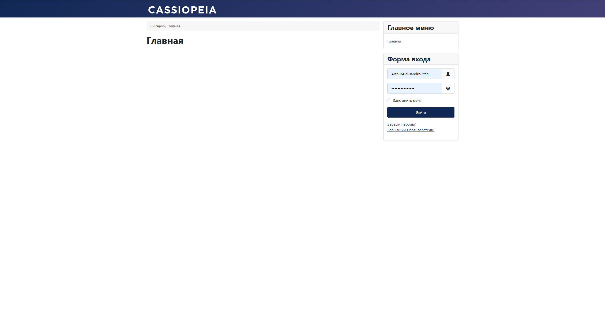
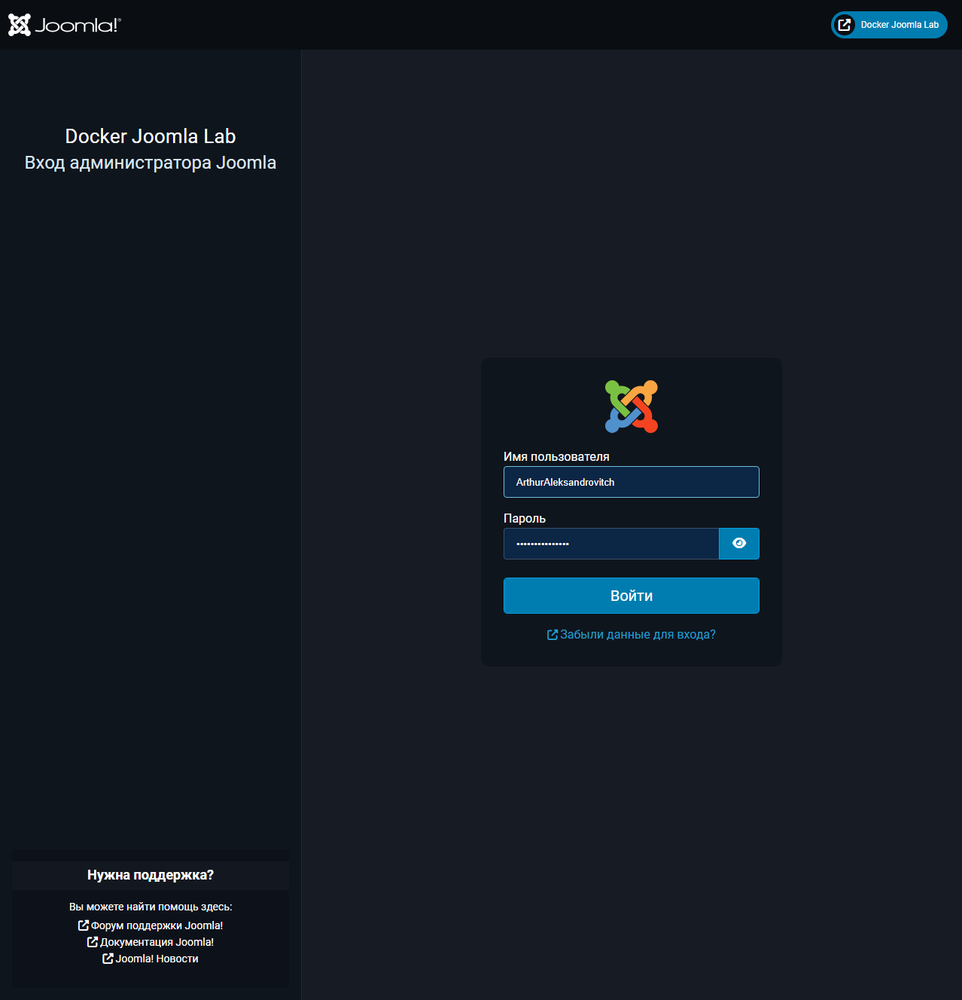
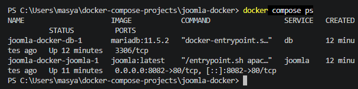
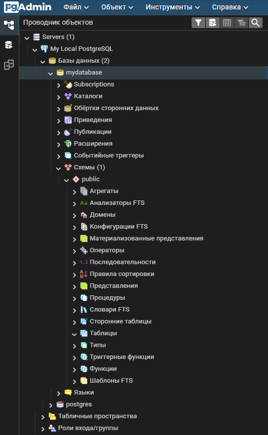
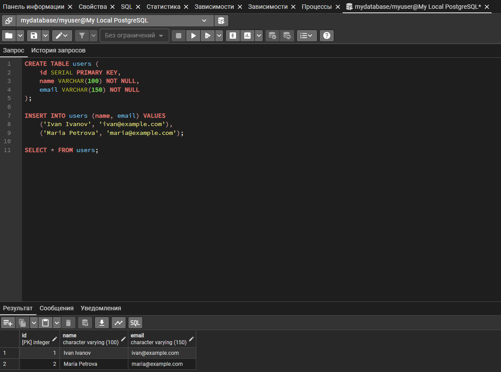
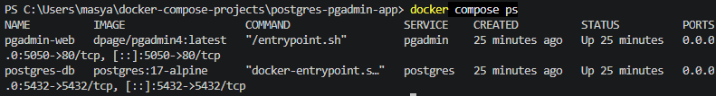
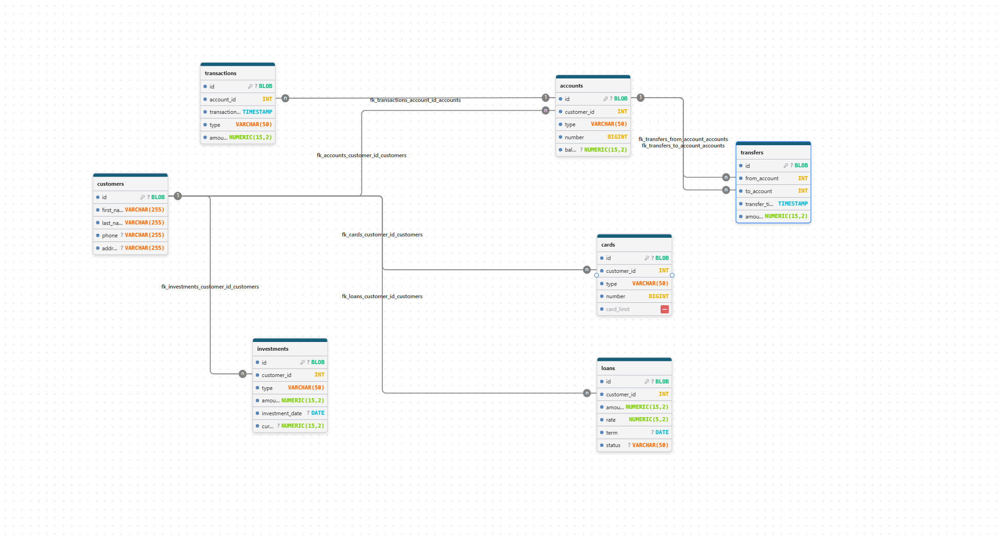
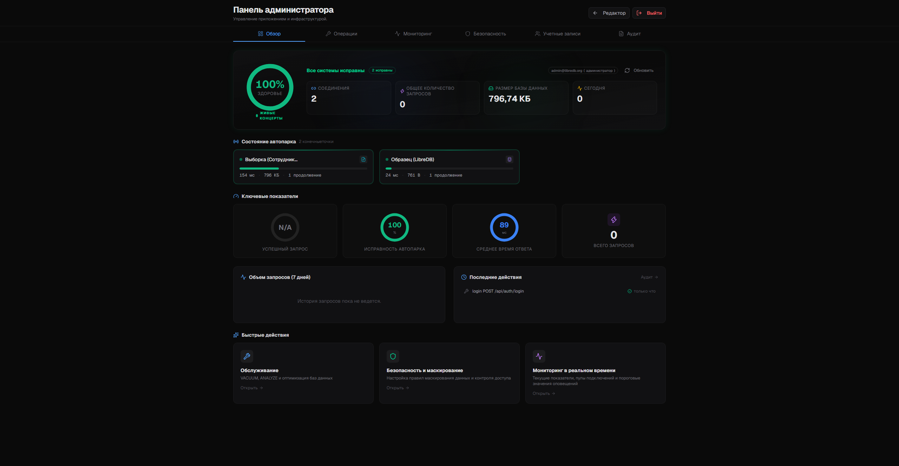
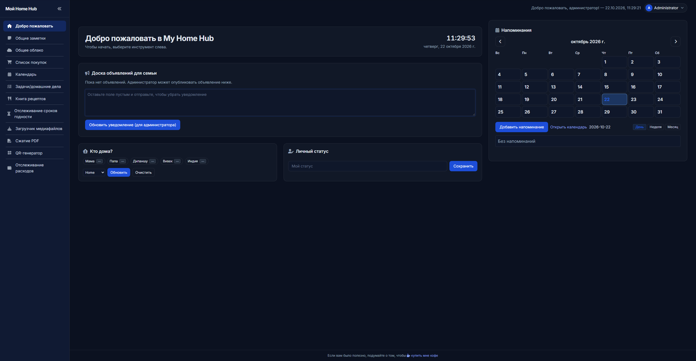
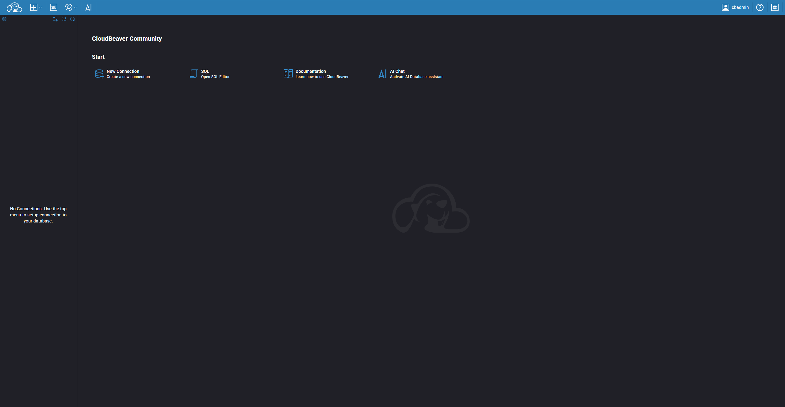

# Проекты Docker Compose

Учебная лабораторная работа по развёртыванию приложений с помощью Docker Compose. Каждый проект расположен в отдельном каталоге общего репозитория и содержит конфигурацию, инструкции по запуску и скриншоты работающего приложения.

## Содержание

| № | Проект | Описание | Статус |
|---|---|---|---|
| 1 | [Joomla + MariaDB](joomla-docker/) | Развёртывание CMS Joomla и базы данных MariaDB | Выполнено |
| 2 | [WordPress + MySQL](wordpress/) | Развёртывание CMS WordPress и базы данных MySQL 8.0 | Выполнено |
| 3 | [MySQL + phpMyAdmin](mysql-pma-app/) | Управление базами данных MySQL через веб-интерфейс phpMyAdmin | Выполнено |
| 4 | [PostgreSQL — Docker Compose](postgres-docker-project/) | Запуск PostgreSQL 15, создание баз данных и проверка SQL-запросов | Выполнено |
| 5 | [PostgreSQL + pgAdmin](postgres-pgadmin-app/) | Управление PostgreSQL через веб-интерфейс pgAdmin и работа с таблицами | Выполнено |
| 6 | [DrawDB — проектирование ER-диаграмм](#drawdb--проектирование-er-диаграмм) | Создание ER-диаграммы банковской системы из семи таблиц | Выполнено |
| 7 | [LibreDB Studio](#libredb-studio) | Веб-интерфейс для работы с базами данных в Docker | Выполнено |
| 8 | [HomeHub](#homehub) | Семейная веб-панель для заметок, покупок, домашних дел и напоминаний | Выполнено |
| 9 | [CloudBeaver](#cloudbeaver) | Веб-клиент для работы с базами данных | Выполнено |

---

## 1. Joomla + MariaDB

**Цель:** изучить контейнеризацию веб-приложения и базы данных, настройку сети, постоянного хранения данных и управление сервисами Docker Compose.

### Используемые технологии

- Docker и Docker Compose
- Joomla CMS
- MariaDB 11.5.2
- YAML

### Структура проекта

```text
joomla-docker/
├── compose.yaml
├── README.md
└── screenshots/
    ├── 01-joomla-homepage.png
    ├── 02-joomla-admin.png
    └── 03-docker-containers.png
```

### Доступ к приложению

- **Сайт:** http://localhost:8082
- **Панель администратора:** http://localhost:8082/administrator

### Архитектура

Проект состоит из двух сервисов:

- `joomla` — веб-приложение Joomla, доступное через порт `8082`.
- `db` — сервер базы данных MariaDB.

Сервисы взаимодействуют через Docker-сеть `joomla-network`. Для хранения данных используются тома `db_data` и `joomla_data`.

### Запуск

```powershell
cd joomla-docker
docker compose config
docker compose up -d
docker compose ps
```

### Полезные команды

```powershell
docker compose logs -f joomla
docker compose logs -f db
docker compose stop
docker compose start
docker compose restart
docker compose down
```

> Команда `docker compose down -v` удаляет именованные тома и сохранённые в них данные. Используйте её только при необходимости полного сброса проекта.

### Скриншоты

**Главная страница Joomla**



**Панель администратора Joomla**



**Запущенные Docker-контейнеры**



---

## 2. WordPress + MySQL

**Цель:** развернуть WordPress с использованием Docker Compose и настроить взаимодействие с базой данных MySQL 8.0.

### Используемые технологии

- Docker и Docker Compose
- WordPress
- MySQL 8.0
- YAML

### Структура проекта

```text
wordpress/
├── compose.yaml
├── README.md
└── screenshots/
    ├── 01-wordpress-homepage.png
    ├── 02-wordpress-admin.png
    └── 03-docker-containers.png
```

### Архитектура

Проект состоит из двух сервисов:

- `wordpress` — веб-приложение WordPress, доступное через порт `8081`.
- `db` — сервер базы данных MySQL 8.0.

Сервисы взаимодействуют через Docker-сеть `wp-network`. Для хранения данных используются тома `db_data` и `wordpress_data`.

### Доступ к приложению

- **Сайт:** http://localhost:8081
- **Панель администратора:** http://localhost:8081/wp-admin/

### Запуск

```powershell
cd wordpress
docker compose config
docker compose up -d
docker compose ps
```

При первом запуске необходимо пройти первоначальную настройку WordPress в браузере и создать учётную запись администратора.

### Полезные команды

```powershell
docker compose logs
docker compose logs wordpress
docker compose logs db
docker compose down
docker compose up -d
```

Команда `docker compose down` останавливает и удаляет контейнеры и сеть проекта, но сохраняет именованные тома с данными.

### Скриншоты

**Главная страница WordPress**


**Панель администратора WordPress**


**Запущенные Docker-контейнеры**


---

## 3. MySQL + phpMyAdmin

**Цель:** развернуть сервер MySQL 8.0 и веб-интерфейс phpMyAdmin с помощью Docker Compose, настроить подключение и проверить работу базы данных.

### Используемые технологии

- Docker и Docker Compose
- MySQL 8.0
- phpMyAdmin
- YAML

### Структура проекта

```text
mysql-pma-app/
├── compose.yaml
├── README.md
└── screenshots/
    ├── 01-phpmyadmin-database.png
    ├── 02-docker-containers.png
    └── 03-mysql-databases.png
```

### Архитектура

Проект состоит из двух сервисов:

- `mysql` — сервер MySQL 8.0, доступный на порту `3306`.
- `phpmyadmin` — веб-интерфейс для управления базой данных, доступный на порту `8083`.

Сервисы взаимодействуют через сеть `mysql-pma-network`. Данные MySQL сохраняются в именованном Docker-томе `mysql_data`.

### Доступ к приложению

- **phpMyAdmin:** http://localhost:8083
- **Сервер MySQL:** `mysql`
- **Пользователь:** `root`
- **База данных:** `my_database`

### Запуск

```powershell
cd mysql-pma-app
docker compose config
docker compose up -d
docker compose ps -a
```

### Полезные команды

```powershell
docker compose logs -f phpmyadmin
docker compose logs -f mysql
docker compose stop
docker compose start
docker compose restart
docker compose down
```

Команда `docker compose down` удаляет контейнеры и сеть проекта, но сохраняет именованный том с данными.

### Скриншоты

**phpMyAdmin и база данных**


**Запущенные Docker-контейнеры**


**Проверка баз данных MySQL**


---

## 4. PostgreSQL — Docker Compose

**Цель:** развернуть PostgreSQL 15 в Docker Compose, настроить инициализацию базы данных SQL-скриптом и проверить работу таблицы с тестовыми данными.

### Используемые технологии

- Docker и Docker Compose
- PostgreSQL 15
- SQL

### Структура проекта

```text
postgres-docker-project/
├── data/
├── scripts/
│   └── init.sql
├── backups/
├── screenshots/
│   ├── 01-postgres-databases.png
│   ├── 02-postgres-users.png
│   └── 03-postgres-container.png
├── docker-compose.yml
└── README.md
```

---

## 5. PostgreSQL + pgAdmin

**Цель:** развернуть PostgreSQL 17 и pgAdmin с помощью Docker Compose, настроить подключение к базе данных и проверить SQL-запросы.

### Используемые технологии

- Docker и Docker Compose
- PostgreSQL 17 Alpine
- pgAdmin 4
- SQL

### Структура проекта

```text
postgres-pgadmin-app/
├── compose.yaml
├── README.md
└── screenshots/
    ├── 01-pgadmin-databases.png
    ├── 02-pgadmin-users.png
    └── 03-pgadmin-containers.png
```

### Архитектура

Проект состоит из двух сервисов:

- `postgres` — сервер PostgreSQL 17, доступный на порту `5432`.
- `pgadmin` — веб-интерфейс для управления базой данных, доступный на порту `5050`.

Сервисы взаимодействуют через внутреннюю сеть Docker Compose. Данные PostgreSQL хранятся в именованном томе `postgres_data`.

### Доступ к приложениям

- **pgAdmin:** http://localhost:5050
- **Сервер PostgreSQL внутри Docker:** `postgres-db`
- **Порт PostgreSQL:** `5432`
- **База данных:** `mydatabase`
- **Пользователь PostgreSQL:** `myuser`

### Запуск

```powershell
cd postgres-pgadmin-app
docker compose config
docker compose up -d
docker compose ps -a
```

После запуска откройте pgAdmin в браузере, войдите в систему и зарегистрируйте сервер PostgreSQL. В настройках подключения укажите имя сервера `postgres-db`, порт `5432`, базу данных `mydatabase` и пользователя `myuser`.

### Полезные команды

```powershell
docker compose logs -f postgres
docker compose logs -f pgadmin
docker compose ps
docker compose stop
docker compose start
docker compose down
```

Команда `docker compose down` удаляет контейнеры и сеть проекта, но сохраняет именованный том с данными. Команда `docker compose down -v` удаляет также том с данными PostgreSQL.

### Скриншоты

**Базы данных в pgAdmin**



**Таблица users с тестовыми записями**



**Запущенные контейнеры PostgreSQL и pgAdmin**



---
## Результаты работы

- Созданы два независимых проекта Docker Compose.
- Joomla развёрнута с MariaDB.
- WordPress развёрнут с MySQL 8.0.
- Развёрнут MySQL 8.0 с помощью Docker Compose.
- Настроен phpMyAdmin для управления базами данных через браузер.
- Проверено подключение к MySQL и наличие базы данных `my_database`.
- Настроены внутренние сети и постоянное хранение данных.
- Подготовлены инструкции по запуску и управлению сервисами.
- Добавлены скриншоты приложений и запущенных контейнеров.
- Развёрнут PostgreSQL 15 с помощью Docker Compose.
- Созданы базы данных и пользователь через SQL-скрипт инициализации.
- Проверена таблица `users` с двумя тестовыми записями.
- Подготовлен каталог `backups` для резервного копирования.
- Развёрнут PostgreSQL 17 с веб-интерфейсом pgAdmin 4.
- Создана таблица `users` и добавлены две тестовые записи.
- Добавлены скриншоты баз данных, таблицы и контейнеров PostgreSQL + pgAdmin.

Каждая следующая лабораторная работа будет добавляться в отдельный каталог этого репозитория.
---

## DrawDB — проектирование ER-диаграмм

В лабораторной работе запущен DrawDB — инструмент для визуального проектирования баз данных.

### Запуск

```powershell
git clone https://github.com/drawdb-io/drawdb.git drawdb
cd drawdb
docker compose -f compose.yml up -d
```

Откройте приложение в браузере: http://localhost:5173/

### Выполненная работа

- Запущен DrawDB с помощью Docker Compose.
- Импортирована SQL-схема банковской системы.
- Создана ER-диаграмма из семи таблиц: `customers`, `accounts`, `cards`, `loans`, `investments`, `transactions`, `transfers`.

### Скриншот



### Полезные команды

```powershell
docker compose -f compose.yml ps
docker compose -f compose.yml logs
docker compose -f compose.yml stop
docker compose -f compose.yml start
docker compose -f compose.yml down
```


---

## LibreDB Studio

**LibreDB Studio** — веб-интерфейс для работы с базами данных, запущенный в Docker-контейнере.

### Используемые технологии

- Docker
- Docker Compose
- LibreDB Studio
- SQLite
- Docker volumes для сохранения данных

### Запуск проекта

Перейдите в каталог проекта:

    cd libredb-studio

Запустите приложение:

    docker compose up -d
    docker compose ps
    docker compose logs --tail=50

Откройте приложение в браузере: http://localhost:3000

При первом запуске пароль администратора генерируется автоматически. Он отображается в логах контейнера. Не публикуйте пароль в репозитории.

### Остановка проекта

    docker compose stop

Повторный запуск:

    docker compose start

Остановка с сохранением данных:

    docker compose down

### Скриншот



---

## HomeHub

**HomeHub** — семейная веб-панель для заметок, списков покупок, домашних дел, рецептов, напоминаний и учёта расходов.

### Используемые технологии

- Docker
- Docker Compose
- HomeHub
- Flask / Gunicorn
- YAML
- Docker volumes и bind mounts

### Запуск проекта

Перейдите в каталог проекта:

    cd homehub

Запустите приложение:

    docker compose up -d
    docker compose ps
    docker compose logs --tail=50

Откройте приложение в браузере: http://localhost:5000

### Конфигурация

- `compose.yml` — настройки контейнера.
- `config.yml` — имя панели, участники семьи и доступные функции.
- `.env` — секретный ключ приложения.

Не публикуйте содержимое `.env` в репозитории. Перед предоставлением доступа другим устройствам рекомендуется установить пароль в `config.yml`.

### Остановка проекта

Остановить контейнер:

    docker compose stop

Повторный запуск:

    docker compose start

Остановить и удалить контейнер, сохранив данные:

    docker compose down

### Скриншот



---

## CloudBeaver

**CloudBeaver** — веб-версия DBeaver для управления подключениями и работы с базами данных через браузер.

### Используемые технологии

- Docker
- Docker Compose
- CloudBeaver Community
- Docker volumes и bind mounts

### Запуск проекта

Перейдите в каталог проекта:

```powershell
cd CloudBeaver
```

Запустите контейнер:

```powershell
docker compose up -d
```

Проверьте состояние:

```powershell
docker compose ps
```

Откройте приложение в браузере: http://localhost:8978

### Конфигурация

Файл `compose.yaml` описывает контейнер CloudBeaver, порт `8978` и постоянное хранение настроек в каталоге `workspace`.

### Управление контейнером

Остановка:

```powershell
docker compose stop
```

Запуск:

```powershell
docker compose start
```

Просмотр логов:

```powershell
docker compose logs --tail=50 cloudbeaver
```

### Скриншот


