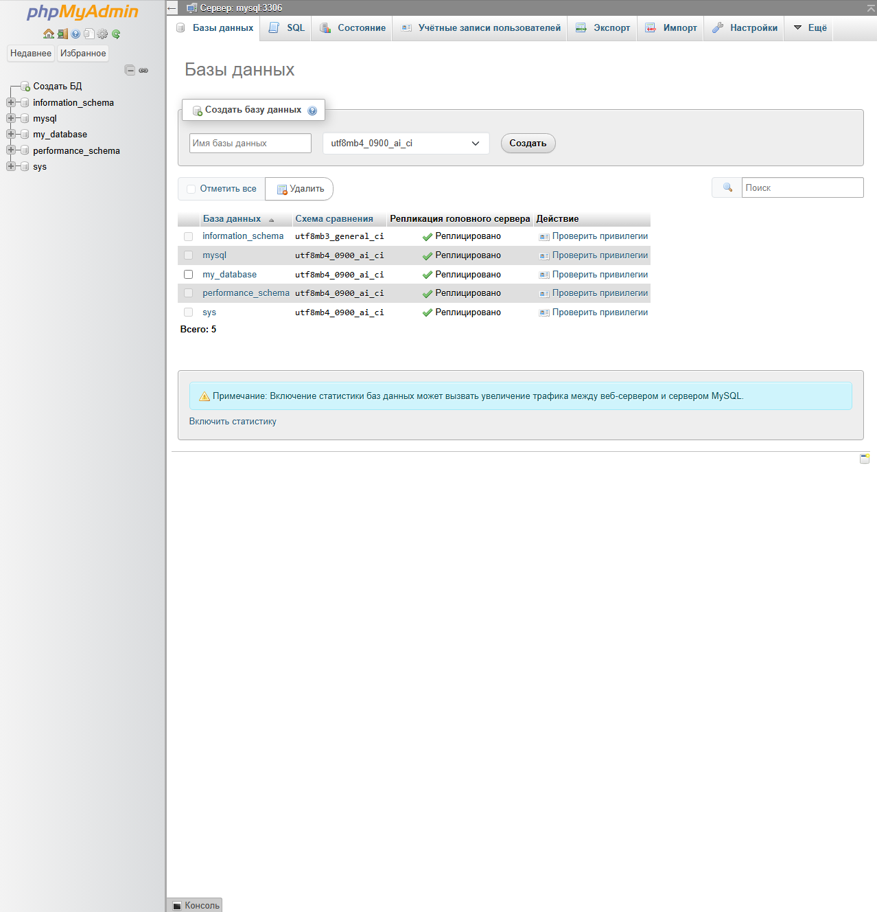
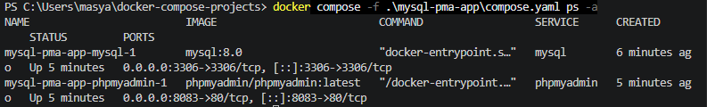
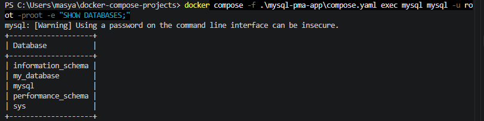

# MySQL + phpMyAdmin — Docker Compose

## Описание

Проект запускает MySQL 8.0 и phpMyAdmin с помощью Docker Compose. phpMyAdmin предоставляет веб-интерфейс для управления базами данных MySQL.

## Технологии

- Docker
- Docker Compose
- MySQL 8.0
- phpMyAdmin

## Запуск проекта

Выполните команды из папки `mysql-pma-app`:

```bash
docker compose up -d
docker compose ps -a
```

## Доступ к phpMyAdmin

- **URL:** http://localhost:8083
- **Сервер MySQL:** `mysql`
- **Пользователь:** `root`
- **Пароль:** `root`
- **База данных:** `my_database`

## Проверка MySQL

```bash
docker compose exec mysql mysql -u root -proot -e "SHOW DATABASES;"
```

## Управление проектом

Остановить контейнеры:

```bash
docker compose stop
```

Запустить снова:

```bash
docker compose start
```

Перезапустить:

```bash
docker compose restart
```

Остановить и удалить контейнеры проекта:

```bash
docker compose down
```

Данные базы хранятся в Docker-томе `mysql_data` и сохраняются после обычной остановки проекта.

## Скриншоты

### 1. phpMyAdmin и база данных



### 2. Работающие Docker-контейнеры



### 3. Проверка баз данных MySQL



## Результат

MySQL 8.0 и phpMyAdmin успешно запущены с помощью Docker Compose. Подключение к серверу проверено, база `my_database` создана, состояние контейнеров подтверждено.