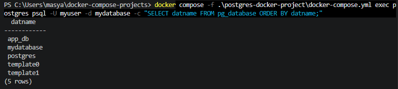
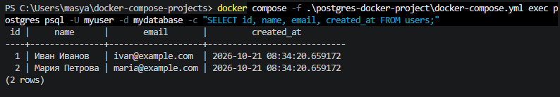
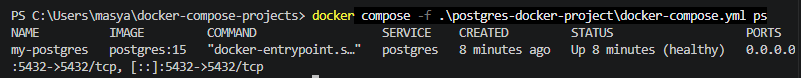

# PostgreSQL — Docker Compose

Учебный проект по запуску PostgreSQL 15 в Docker Compose, созданию баз данных и пользователя, а также проверке SQL-таблицы с тестовыми данными.

## Используемые технологии

- Docker
- Docker Compose
- PostgreSQL 15
- SQL

## Структура проекта

```text
postgres-docker-project/
├── data/                  # Файлы базы данных PostgreSQL
├── scripts/
│   └── init.sql           # Инициализация БД и тестовой таблицы
├── backups/               # Каталог для резервных копий
├── screenshots/           # Скриншоты результатов
│   ├── 01-postgres-databases.png
│   ├── 02-postgres-users.png
│   └── 03-postgres-container.png
├── docker-compose.yml
└── README.md
```

## Конфигурация базы данных

- **Образ:** `postgres:15`
- **Контейнер:** `my-postgres`
- **Основная база:** `mydatabase`
- **Пользователь:** `myuser`
- **Порт:** `5432`
- **Дополнительная база:** `app_db`
- **Дополнительный пользователь:** `app_user`

Учебные пароли указаны в `docker-compose.yml` и `scripts/init.sql`. Не используйте их в реальных системах.

## Запуск проекта

Из каталога проекта выполните:

```powershell
docker compose config
docker compose up -d
docker compose ps
```

Проверить логи:

```powershell
docker compose logs postgres
```

## Подключение к PostgreSQL

Подключение к основной базе данных:

```powershell
docker compose exec postgres psql -U myuser -d mydatabase
```

Список баз данных:

```sql
\l
```

Просмотр тестовых записей:

```sql
SELECT id, name, email, created_at FROM users;
```

Выход из интерактивного клиента:

```sql
\q
```

## Управление контейнером

Остановить контейнеры, не удаляя их:

```powershell
docker compose stop
```

Запустить остановленные контейнеры:

```powershell
docker compose start
```

Остановить и удалить контейнеры и сеть:

```powershell
docker compose down
```

Данные сохраняются в каталоге `data`. Команда `docker compose down` не удаляет этот каталог. Не удаляйте `data`, если хотите сохранить базу.

## Резервное копирование

Создать логический дамп основной базы данных в файл `backups/mydatabase.sql`:

```powershell
docker compose exec -T postgres pg_dump -U myuser -d mydatabase > .\backups\mydatabase.sql
```

## Скриншоты

### Список баз данных



### Тестовые записи таблицы users



### Состояние контейнера



## Результат

- Запущен PostgreSQL 15 в Docker Compose.
- Созданы базы `mydatabase` и `app_db`.
- Создан пользователь `app_user`.
- Создана таблица `users` и добавлены две тестовые записи.
- Проверена готовность контейнера и выполнение SQL-запросов.
- Подготовлен каталог для резервных копий базы данных.