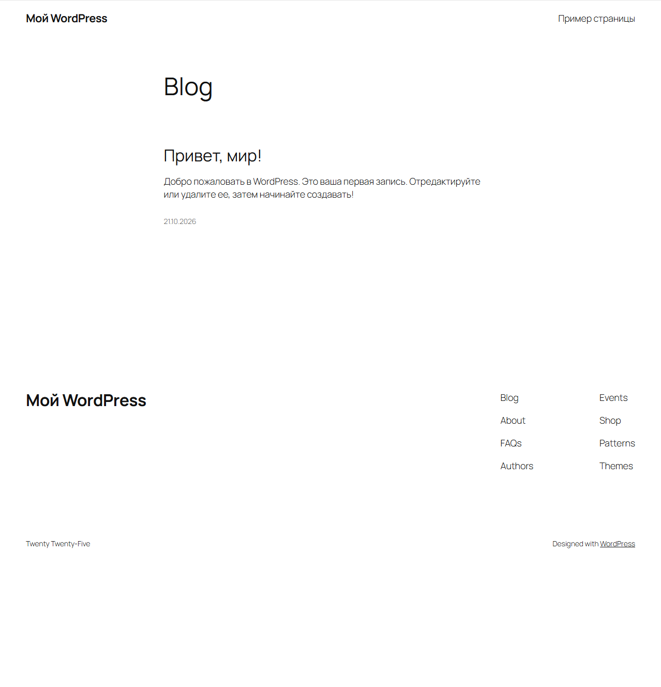
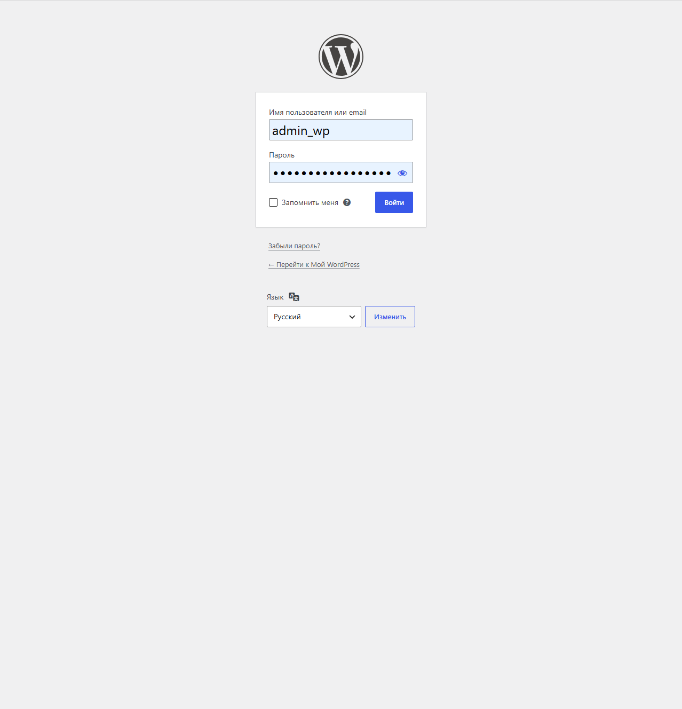
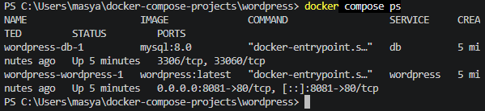

# WordPress с Docker Compose

## Цель работы

Развернуть систему управления содержимым WordPress с использованием Docker Compose и базы данных MySQL 8.0.

## Используемые технологии

- Docker
- Docker Compose
- WordPress
- MySQL 8.0

## Структура проекта

```text
wordpress/
├── compose.yaml
├── README.md
└── screenshots/
    ├── 01-wordpress-homepage.png
    ├── 02-wordpress-admin.png
    └── 03-docker-containers.png
```

## Архитектура проекта

Проект состоит из двух сервисов:

- **wordpress** — веб-приложение WordPress, доступное на порту `8081`.
- **db** — сервер базы данных MySQL 8.0.

Для взаимодействия сервисов используется внутренняя сеть `wp-network`.

Для сохранения данных при перезапуске контейнеров используются Docker volumes:

- `db_data` — данные MySQL.
- `wordpress_data` — файлы WordPress.

## Запуск проекта

Перейти в каталог проекта:

```powershell
cd wordpress
```

Проверить конфигурацию Docker Compose:

```powershell
docker compose config
```

Запустить контейнеры:

```powershell
docker compose up -d
```

Проверить состояние сервисов:

```powershell
docker compose ps
```

## Установка WordPress

Открыть в браузере:

- Главная страница: http://localhost:8081
- Панель администратора: http://localhost:8081/wp-admin/

После первого запуска необходимо пройти первоначальную настройку WordPress и создать учётную запись администратора.

## Полезные команды

Просмотр логов:

```powershell
docker compose logs
```

Просмотр логов WordPress:

```powershell
docker compose logs wordpress
```

Просмотр логов базы данных:

```powershell
docker compose logs db
```

Остановка контейнеров без удаления данных:

```powershell
docker compose down
```

Повторный запуск:

```powershell
docker compose up -d
```

## Скриншоты

### Главная страница WordPress



### Панель администратора



### Запущенные Docker-контейнеры



## Результат работы

WordPress развёрнут с помощью Docker Compose и подключён к базе данных MySQL 8.0. Данные сервисов сохраняются в именованных Docker volumes. Веб-приложение доступно по адресу http://localhost:8081.

Лабораторная работа выполнена.


